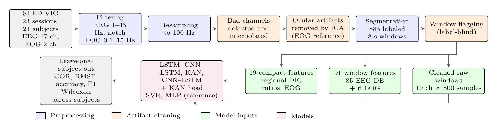
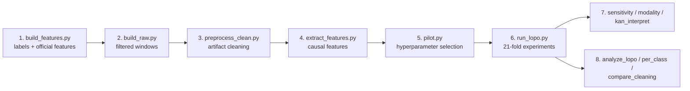
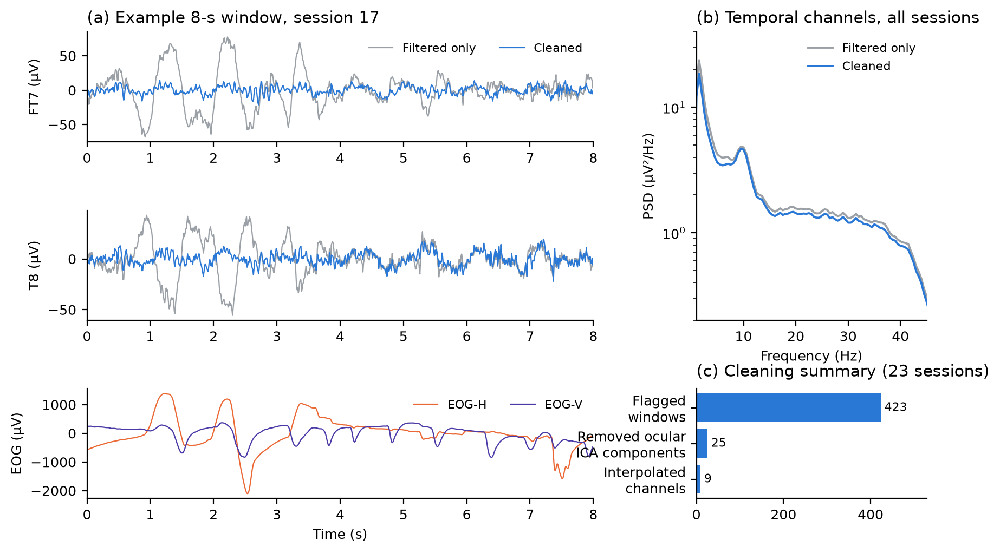
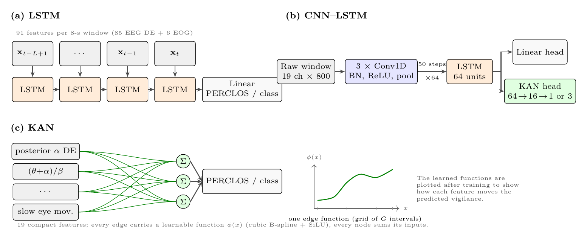
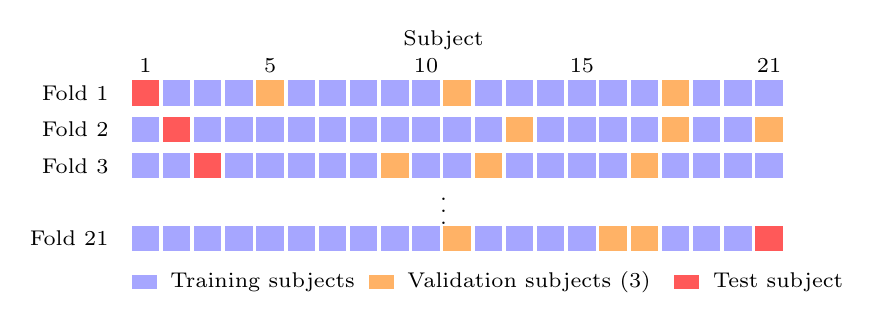
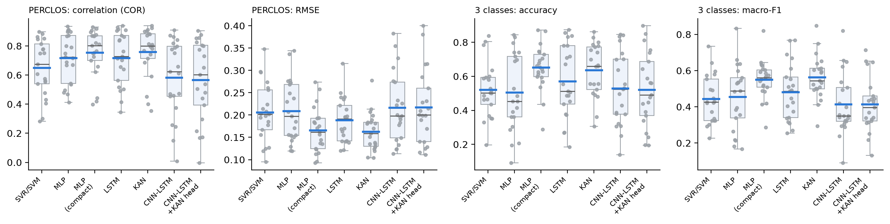
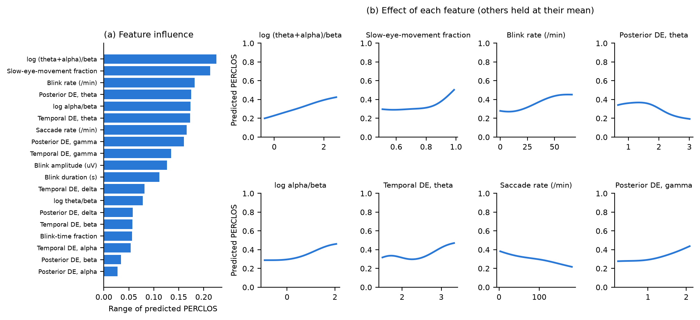

# CNN–LSTM and Kolmogorov–Arnold Networks for Subject-Independent Driver Drowsiness Estimation from EEG and Forehead EOG

Code for estimating the vigilance of drivers who were **not seen during training**, using EEG and forehead EOG from the public **SEED-VIG** dataset. The pipeline cleans the recordings, extracts features that can be computed in real time, and compares an **LSTM**, a **CNN–LSTM**, a **Kolmogorov–Arnold network (KAN)**, and a **CNN–LSTM with a KAN prediction head** under leave-one-subject-out evaluation.

**Main findings**

- A compact set of **19 physiologically motivated features** gives the most accurate estimates for new drivers.
- On these features, the **KAN** matches the best model and has a significantly lower error than the LSTM and the raw-signal CNN–LSTMs.
- The KAN's learned functions are interpretable: predicted drowsiness rises with EEG slowing, (θ+α)/β, and with slow eye movements above a threshold of about 0.85, and falls with saccade rate.



---

## Contents

1. [Results at a glance](#1-results-at-a-glance)
2. [Repository structure](#2-repository-structure)
3. [Installation](#3-installation)
4. [Getting the SEED-VIG data](#4-getting-the-seed-vig-data)
5. [How the program works, step by step](#5-how-the-program-works-step-by-step)
6. [Models](#6-models)
7. [Evaluation protocol](#7-evaluation-protocol)
8. [Figures](#8-figures)
9. [Running time](#9-running-time)
10. [Citation](#10-citation)

---

## 1. Results at a glance

These are leave-one-subject-out results, shown as the mean ± standard deviation over 21 subjects (`results/seedvig/stats_*_clean.json`).

| Model | Input | PERCLOS COR ↑ | PERCLOS RMSE ↓ | 3-class accuracy ↑ | 3-class macro-F1 ↑ |
|---|---|---|---|---|---|
| SVR / SVM | 91 window features | 0.648 ± 0.189 | 0.206 ± 0.064 | 0.520 ± 0.158 | 0.443 ± 0.129 |
| MLP | 91 window features | 0.715 ± 0.165 | 0.208 ± 0.067 | 0.504 ± 0.223 | 0.455 ± 0.176 |
| LSTM | 91 features, 20-window sequences | 0.716 ± 0.180 | 0.188 ± 0.049 | 0.570 ± 0.208 | 0.481 ± 0.153 |
| CNN–LSTM | cleaned raw signals | 0.581 ± 0.257 | 0.216 ± 0.077 | 0.529 ± 0.211 | 0.414 ± 0.165 |
| CNN–LSTM + KAN head | cleaned raw signals | 0.565 ± 0.270 | 0.217 ± 0.082 | 0.521 ± 0.211 | 0.414 ± 0.148 |
| MLP | 19 compact features | 0.752 ± 0.159 | 0.166 ± 0.049 | **0.650 ± 0.129** | 0.550 ± 0.103 |
| **KAN** | **19 compact features** | **0.758 ± 0.169** | **0.163 ± 0.041** | 0.635 ± 0.152 | **0.562 ± 0.118** |

Models are compared with paired Wilcoxon tests across the 21 subjects, with Holm correction.

- **Against the LSTM, the 91-feature models and both CNN–LSTMs,** the KAN has a significantly lower RMSE.
- **Against the MLP on the same 19 features,** the KAN is statistically indistinguishable, but the KAN's learned functions can be inspected.

---

## 2. Repository structure

```
.
├── scripts/seedvig/        all code (run from this folder)
│   ├── run_pipeline.sh     runs every step below in order
│   ├── build_features.py   step 1  official features + labels
│   ├── build_raw.py        step 2  filtered raw windows
│   ├── preprocess_clean.py step 3  artifact cleaning
│   ├── extract_features.py step 4  causal features (DE, EOG, compact set)
│   ├── check_features.py   step 4  feature checks
│   ├── plot_cleaning.py    step 4  cleaning figure
│   ├── splits.py           leave-one-subject-out folds
│   ├── models.py           LSTM, CNN–LSTM, B-spline KAN layer, KAN, MLP
│   ├── train_lib.py        data loading, training, early stopping, metrics
│   ├── pilot.py            step 5  hyperparameter selection
│   ├── run_lopo.py         step 6  main experiments + cleaning ablation
│   ├── feature_sets_full.py, sensitivity.py, modality.py, kan_interpret.py   step 7
│   └── analyze_lopo.py, compare_cleaning.py, per_class.py, rescore_cls.py   step 8
├── results/seedvig/        result summaries (JSON); large arrays are regenerated
├── figures/seedvig/        result figures
├── docs/images/            diagrams used in this README
├── data/                   SEED-VIG goes here (not included, see Section 4)
└── requirements.txt
```

---

## 3. Installation

The results were produced with Python 3.13.2.

```bash
git clone https://github.com/Helloworldceo/Alain_DDD-dataset.git
cd Alain_DDD-dataset
python3 -m pip install -r requirements.txt
```

A GPU is optional. PyTorch uses CUDA or Apple Metal (MPS) when available, otherwise the CPU.

---

## 4. Getting the SEED-VIG data

SEED-VIG is provided by the Center for Brain-like Computing and Machine Intelligence, Shanghai Jiao Tong University, under a license agreement. It is **not** included in this repository.

1. Apply for access at <https://bcmi.sjtu.edu.cn/home/seed/seed-vig.html>.
2. Download the dataset folder and place it as `data/SEED-VIG/`:

```
data/SEED-VIG/
├── Raw_Data/              23 .mat files: EEG (17 ch, 200 Hz), EOG (125 Hz)
├── EEG_Feature_5Bands/    official DE/PSD features
├── EOG_Feature/           official 36 EOG features
├── perclos_labels/        PERCLOS label for every 8-s segment
└── ...
```

---

## 5. How the program works, step by step

Run everything at once:

```bash
cd scripts/seedvig
./run_pipeline.sh            # or: PYTHON=/path/to/python ./run_pipeline.sh
```

Or run the steps one by one, in the order below. Every step reads the outputs of the previous one from `results/seedvig/`.



### Step 1. Labels and official features: `build_features.py`

- Reads the 23 sessions (21 subjects), each with 885 consecutive 8-second segments, giving 20,355 samples in total.
- Collects the PERCLOS label of each segment (0 = awake … 1 = drowsy), and assigns 3 classes: awake < 0.35 ≤ tired < 0.7 ≤ drowsy.
- Also stores the official SEED-VIG features. These are smoothed over the whole session, so they are used only for comparison.
- **Output:** `features.npz`

### Step 2. Filtered raw windows: `build_raw.py`

- **EEG:** 50 Hz notch filter, band-pass 1–45 Hz, resampled from 200 to 100 Hz.
- **EOG,** vertical and horizontal: band-pass 0.1–15 Hz, resampled from 125 to 100 Hz.
- The signals are cut into the 885 labelled windows per session, each 19 channels × 800 samples.
- This "filtered only" version is the baseline for the cleaning ablation.
- **Output:** `raw_windows.npy`, `raw_meta.npz`

### Step 3. Artifact cleaning: `preprocess_clean.py`

Cleaning runs on each continuous session, before windowing:

1. **Bad channels.** A channel is bad if its SD is below 0.15× or above 4× the session median, or if more than 5% of its samples exceed 200 µV. Bad channels are rebuilt by spherical-spline interpolation.
2. **Ocular artifacts.** Extended-Infomax ICA runs on the EEG. A component is removed if its time course correlates with the EOG at |r| ≥ 0.30, or at |r| ≥ 0.20 if it also stands out from the session's other components (z ≥ 3). At most 3 components are removed per session.
3. **Window flagging.** A window is flagged if its peak-to-peak amplitude is above the session median by more than 5 robust SDs, or if a channel is flat. The labels are never used. Flagged windows are left out of training but always tested.

- **Outcome:** 9 channels interpolated, 25 ocular components removed, and 423 of 20,355 windows (2.1%) flagged.
- **Output:** `clean_windows.npy`, `clean_meta.npz`, `cleaning_report.json`



### Step 4. Causal feature extraction: `extract_features.py`

Every feature uses only the current window, so it can be computed while driving. Smoothing, where used, is a causal mean of the current and the 4 previous windows, covering 40 seconds.

| Feature group | Features |
|---|---|
| EEG differential entropy (85) | DE = ½ log(2πe·P_band) for 17 channels × 5 bands (δ 1–4, θ 4–8, α 8–14, β 14–31, γ 31–45 Hz), with P_band from Welch's PSD |
| EOG (6) | blink rate, blink amplitude, blink duration, blink-time fraction, saccade rate, slow-eye-movement fraction |
| **Compact set (19)** | temporal and posterior mean DE in each band (10), posterior log θ/β, α/β, (θ+α)/β (3), and the 6 EOG features |

How the EOG features are measured:
- **Blink polarity.** Blink polarity is set per session from the skewness of the vertical EOG; blinks are negative deflections in 21 of 23 sessions.
- **Blinks** are peaks of the 10 Hz low-passed vertical EOG, 0.05–3 s wide, above a per-session threshold.
- **Saccades** are peaks of the horizontal EOG velocity.

`check_features.py` compares these features with the official ones; the median correlation is 0.908. `plot_cleaning.py` draws the cleaning figure.

- **Output:** `features_causal.npz`, `feature_checks.json`, `figures/seedvig/fig_seedvig_cleaning.png`

### Step 5. Hyperparameter selection: `pilot.py reg` and `pilot.py cls`

- Uses the first 3 leave-one-subject-out folds, with test subjects 1, 2 and 3.
- Each configuration in a pre-stated grid is trained once on the training subjects and scored on 3 validation subjects.
- The configuration with the lowest mean validation loss is fixed for all folds. Test-subject scores are never used.

| Model | Search range | Selected (PERCLOS / 3 classes) |
|---|---|---|
| LSTM | L ∈ {5, 10, 20} windows | L = 20 / L = 20 |
| KAN | width H ∈ {8, 16, 32}, grid G ∈ {5, 10} | 16, 5 / 16, 10 |
| all neural models | learning rate ∈ {1e-3, 3e-4} | 1e-3, except the 91-feature MLP for 3 classes: 3e-4 |

- **Output:** `pilot_reg.json`, `pilot_cls.json`

### Step 6. Leave-one-subject-out experiments: `run_lopo.py`

```bash
python3 run_lopo.py reg                # PERCLOS regression, cleaned signals
python3 run_lopo.py cls                # three-state classification
python3 run_lopo.py reg signals=raw    # cleaning ablation: filtered-only signals
python3 run_lopo.py reg models=KAN     # a single model
```

For each of the 21 folds:
1. One subject is the test set. Subjects 4 and 5 recorded two sessions, and both sessions are held out together.
2. Three other subjects are validation data for early stopping.
3. The rest are training data.

Each neural model is trained with 3 seeds, using Adam, batch size 128, at most 60 epochs, and early stopping with a patience of 10. The test predictions are averaged over the seeds. Scores are computed per test subject. The script resumes automatically if it is interrupted.

- **Output:** `lopo_<task>_<signals>.json`, `lopo_<task>_<signals>_pred.npz`

### Step 7. Additional analyses

| Script | What it does | Output |
|---|---|---|
| `feature_sets_full.py` | compares feature sets with the SVR on the same splits | `feature_sets_full.json` |
| `sensitivity.py` | runs the runner-up KAN and LSTM configurations on all 21 folds | `sensitivity_reg.json` |
| `modality.py` | trains the KAN on the EEG part (13) and the EOG part (6) of the compact set | `modality_reg.json` |
| `kan_interpret.py` | trains the KAN on all subjects and plots each feature's effect on the predicted PERCLOS | `kan_interpretation.json`, `fig_kan_effects.png` |

### Step 8. Statistics and figures

| Script | What it does | Output |
|---|---|---|
| `analyze_lopo.py` | per-model mean ± SD, paired Wilcoxon tests with Holm correction and rank-biserial effect sizes, per-subject figure | `stats_*_clean.json`, `fig_lopo_per_person_clean.png` |
| `compare_cleaning.py` | cleaned vs. filtered-only, for every model | `cleaning_ablation.json` |
| `per_class.py` | per-class F1 and confusion matrices for the 3-class task | `per_class_cls.json` |
| `rescore_cls.py` | recomputes 3-class scores from saved predictions, with macro-F1 over the classes present for each subject | updates `lopo_cls_clean.json` |

---

## 6. Models



| Model | Input | How it works | Parameters |
|---|---|---|---|
| LSTM | 91 features of the current and previous L−1 windows | Gated recurrent memory over 20 windows (160 s), with one layer of 64 units | 40,257 |
| CNN–LSTM | cleaned raw window, 19 ch × 800 | 3 Conv1D blocks (32/64/64 filters) turn the window into 50 steps of 160 ms, read by an LSTM with 64 units | 72,897 |
| CNN–LSTM + KAN head | same as above | the linear output layer is replaced by a KAN (64 → 16 → output) | 83,360 |
| KAN | 19 compact features | a learnable cubic B-spline plus SiLU function on every edge, φ(x) = w_b·SiLU(x) + w_s·Σ c_k B_k(x), with one hidden layer of width 16 | 3,200 |
| MLP (control) | 19 compact features | two hidden layers (64, 32), dropout 0.3 | 3,393 |
| SVR / SVM (reference) | 91 features | RBF kernel, C = 1 | – |

The B-spline KAN layer is implemented directly in PyTorch, in `models.py` under `KANLayer`, using the Cox–de Boor recursion. Each learned edge function can be evaluated and plotted with `KANLayer.edge_function`.

---

## 7. Evaluation protocol



**Metrics:**
- **PERCLOS regression:** Pearson correlation (COR) and RMSE.
- **3 classes:** accuracy and macro-F1, the latter computed over the classes present in each subject's data.

**Statistics:** each subject is an independent test case. Models are compared with the Wilcoxon signed-rank test across the 21 subjects, Holm-corrected over all model pairs, with the rank-biserial effect size.

---

## 8. Figures

**Score of every test subject** (points), with box plots and means (blue bars):



**Learned KAN effects.** These show how each compact feature moves the predicted PERCLOS when the other features are held at their mean:



---

## 9. Running time

These are approximate times on an Apple M3 Pro (MPS), per fold, for 3 seeds and the PERCLOS task:

| Model | Time per fold |
|---|---|
| SVR | 2 s |
| MLP | 13–16 s |
| KAN | 22 s |
| LSTM | 27 s |
| CNN–LSTM | 102 s |
| CNN–LSTM + KAN head | 135 s |

- **Full pipeline:** the main experiments for both tasks take about 4 hours. The cleaning ablation adds about 2 hours.
- **Preprocessing,** steps 1–4, takes a few minutes.

---

## 10. Citation

The paper describing this work is under review; the citation will be added after publication. If you use the SEED-VIG dataset, please cite:

> W.-L. Zheng and B.-L. Lu, "A multimodal approach to estimating vigilance using EEG and forehead EOG," *Journal of Neural Engineering*, vol. 14, no. 2, p. 026017, 2017.
